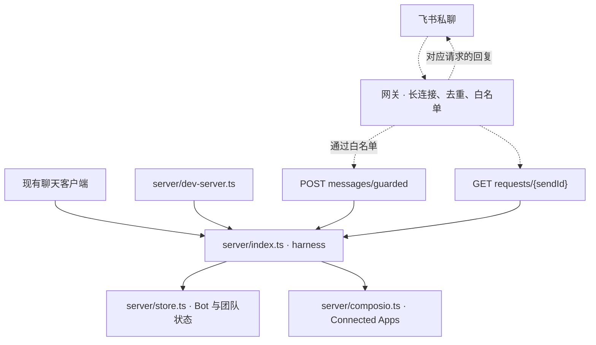

# Design notes: add-feishu-gateway（飞书网关，MVP1 瘦身版）

> 对应改造方案 MVP1。正式写代码前，先把“待核对”逐项对上本地目录树（`/Users/latiao/OpenMausBot`）。

## 设计要点

- **模式**：WebSocket 长连接（学 Hermes），不用公网地址、不配域名，适合先跑通。
- **位置**：网关是独立适配器，挂在现有消息入口旁边；消息进来后走原来
  “聊天 → bot → 电脑”的同一条路，不另起一套调度。
- **事件**：只收 `im.message.receive_v1`（私聊文本消息）。卡片回调 `card.action.trigger`
  这次不接，那是 MVP2 `add-approval` 的事。
- **鉴权**：白名单，陌生人拒绝。白名单放本地配置，不进仓库。
- **转发**：先直接转给一个固定 Bot，不做 Jev 分流、不做模型选择（MVP3 再做）。
- **去重**：按飞书事件 id 去重，网关重启后已收到的消息不重复回。
- **重连**：WebSocket 断线后指数退避重连；重连期间收到的消息不丢（飞书侧会重推，按事件去重）。
- **配置**：App ID / App Secret 只放本地配置或环境变量，不进仓库、不进 change 文件。
- **不做 Ticket**：MVP1 的消息不生成 Ticket、不写 Mandate；工单是 MVP2 `add-ticket` 的事。
  MVP1 的审计就是：git 提交 + `handoff.md` + 飞书消息记录。

## 流转图（文字版）

```
飞书私聊发一句话
  → 网关（WebSocket，收 im.message.receive_v1）
  → 白名单检查：不在名单 → 拒绝，记日志，不回
  → 在名单 → 转给固定 Bot
  → Bot 回一句话 → 网关发回飞书私聊
```

## 第 0 步本地结构核对（2026-11-25）

实线是基线中已有的模块或调用，虚线是拟新增的飞书消息路径。



- `GET /api/bots?messages=0` 用于查看 Bot 与团队。本次隔离验证选用 FeishuBaselineProbe，实例内 Bot ID 见 handoff.md。
- 网关接现有外部消息 HTTP 接口。先查 `/api/health` 的 `guardedMessages` 能力，发送时固定 Bot 和会话，提交稳定的 `sendId` 及当前 `expectedActiveLeafId`。按该请求取结果，避免读到其他会话的回复。
- 在仓库业务源码及依赖清单中搜索 `feishu` 和 `larksuite` 未找到现成飞书适配器。Composio 处理 Connected Apps 授权，飞书长连接作为独立入口。

## 待核对（对照本地目录树，动手前逐项打勾）

- [x] harness 源码入口已定位，本次隔离实例监听 `127.0.0.1:19896`。
- [x] bot 列表 / 团队在本地的真实文件名和加载方式；固定 Bot 选哪一个。
- [x] 连接器模块在本地的真实路径；飞书网关是否复用同一套连接器接口。
- [x] 本地有没有现成的飞书相关代码或依赖（搜 `feishu` / `lark`），有就复用，没有再新写。
- [x] 「辣条」已配置长连接并开通单聊读取权限，凭据保存在仓库外的本地配置中。

## 不确定的事（先记下来，别猜）

- Hermes 的飞书实现细节以其仓库为准，本包没抄它的代码，只借了“WebSocket 长连接”的做法。
- 群聊、日报、审批卡片、文件收发都不在本 change 里，见 README 的去向表。
